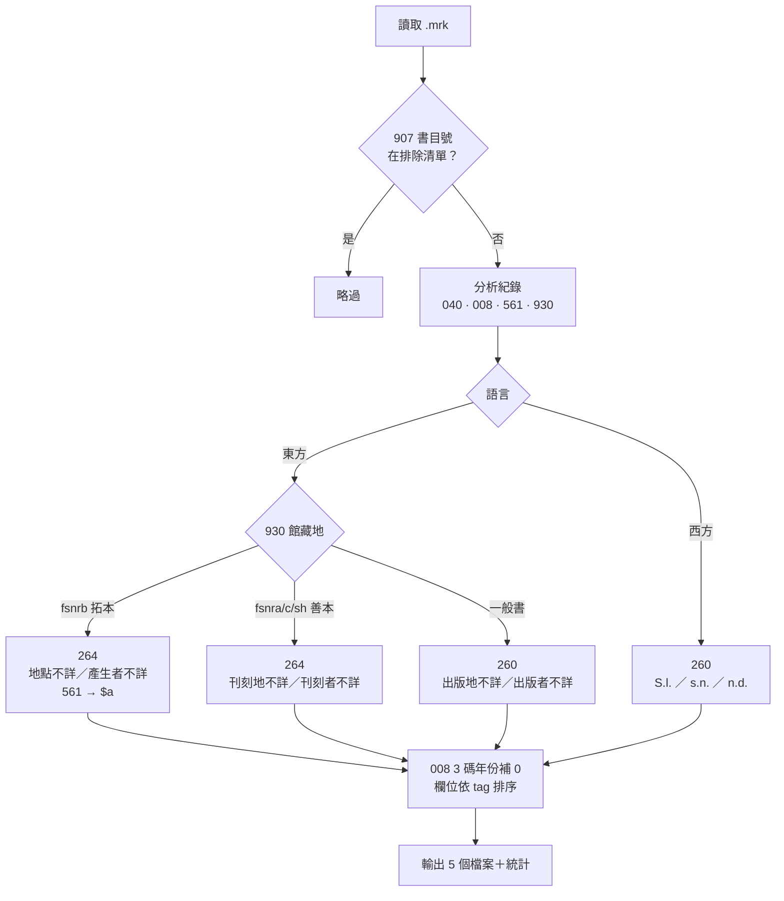
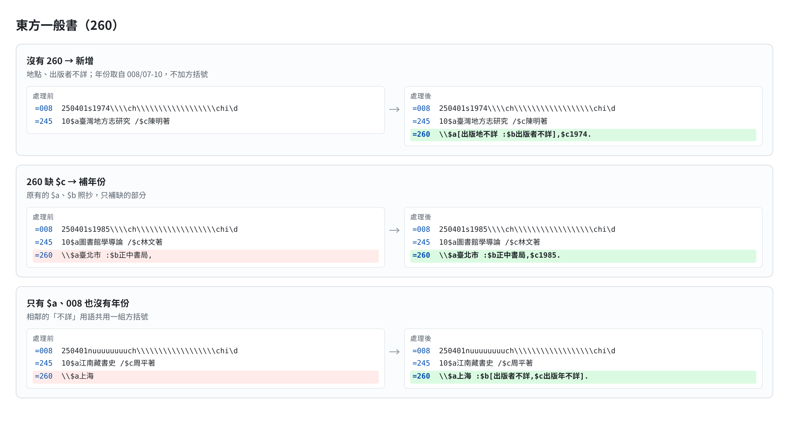
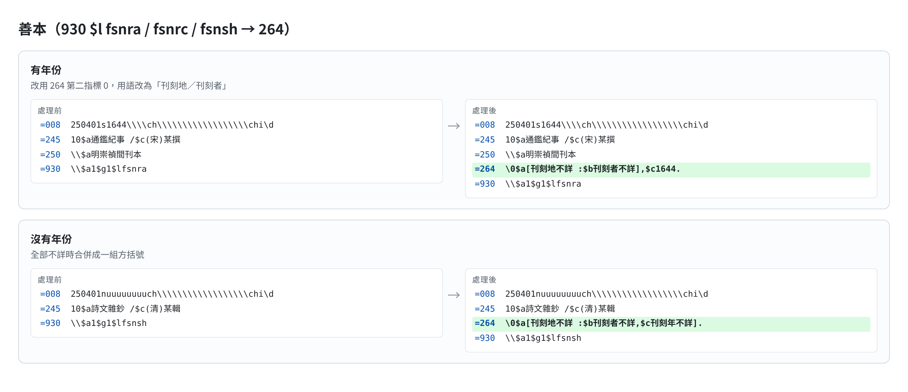
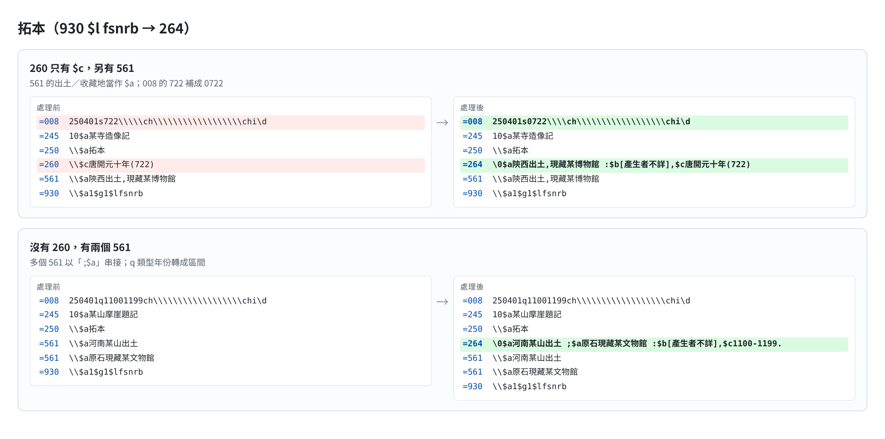
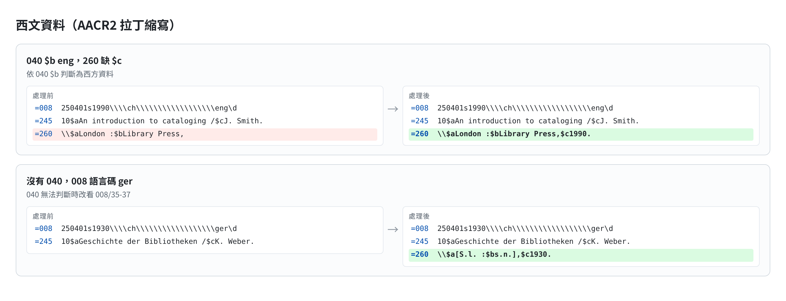
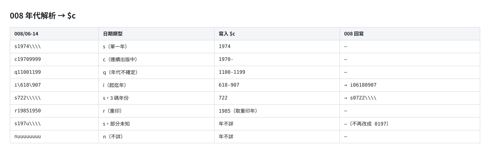
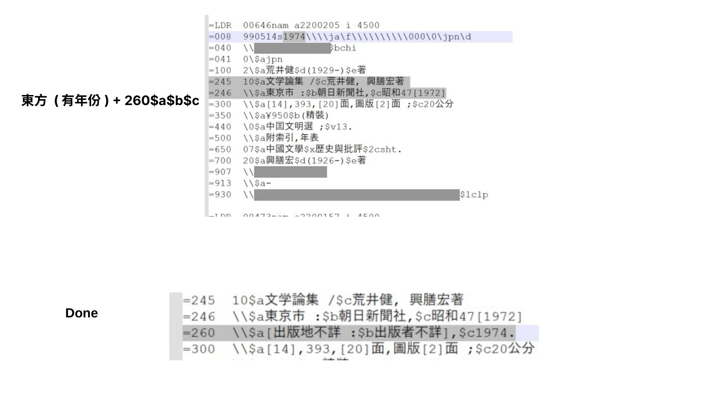
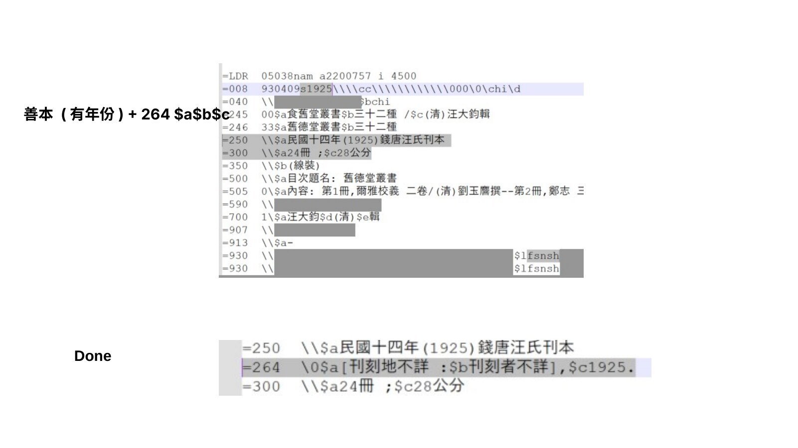
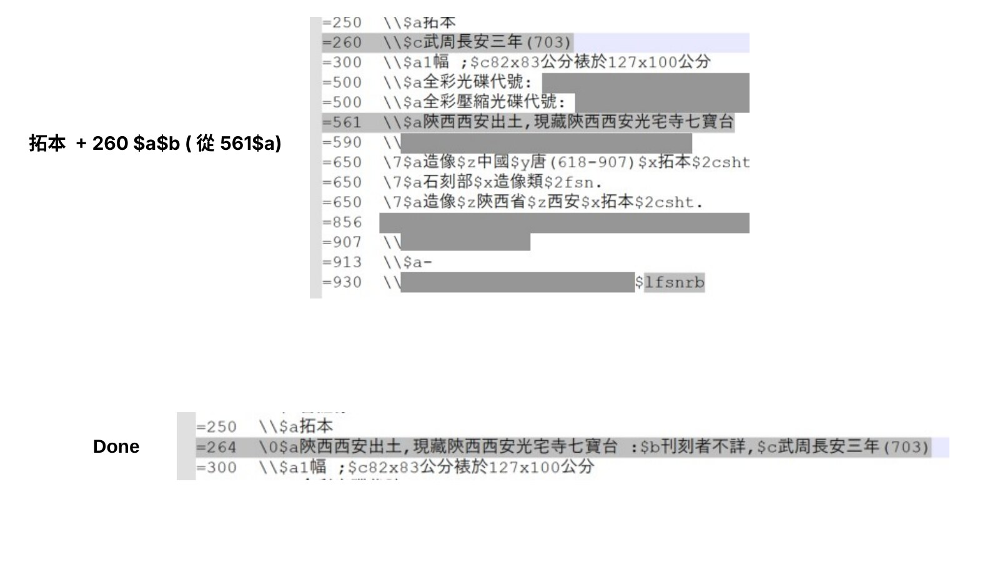

# MARC21 Imprint Autofill

**MARC21 sparse record 出版項（260/264）批次補齊工具**

  

> A Python tool that batch-fixes MARC21 sparse records before loading them into OCLC WorldCat: it fills in missing 260/264 publication statements, takes dates from field 008, normalizes ISBD punctuation, and applies separate rules for Chinese rare books and rubbings.

這是我 2025 年在 OCLC 實習時寫的程式。客戶要匯入 WorldCat 的書目裡，有一批 sparse record（簡略書目）缺少出版項，單一批次就有 2 萬多筆。這支程式把跟客戶確認過的著錄規則寫成程式，批次補齊 260/264，再產出一份「只含有改動的紀錄」供抽查。處理結果已交由客戶確認，所有需要補齊的紀錄都已正確修改。

---

## 目錄

- [問題](#問題)
- [處理規則](#處理規則)
- [處理流程](#處理流程)
- [範例](#範例)
- [快速開始](#快速開始)
- [輸出檔案](#輸出檔案)
- [設計重點](#設計重點)
- [實習時的規則確認簡報](#實習時的規則確認簡報)
- [限制與聲明](#限制與聲明)

---

## 問題

手動補一筆出版項，要依序判斷好幾件事：

1. **語言**：東方資料用「出版地不詳」，西文資料用 AACR2 的 `[S.l. : s.n., n.d.]`
2. **資料類型**：一般書用 260；善本用 264，寫「刊刻地／刊刻者」；拓本也用 264，寫「地點／產生者」，地點可以從 561（來源／出土資訊）取得
3. **年份**：要從 008 依日期類型（`s`、`c`、`m`、`q`、`r`…）解析，3 碼年份（例如唐代的 722 年）還要回寫 008 並補 0
4. **ISBD 標點**：` :$b`、`,$c`、結尾句點，以及「不詳」用語加方括號、相鄰的不詳用語共用同一組方括號（從 008 帶入的年份則不加）

2 萬多筆紀錄都這樣手動做，費時又容易出錯，所以我把這些規則寫成程式。

## 處理規則

| 判斷依據 | 類型 | 欄位 | 「不詳」用語 |
|---|---|---|---|
| 040 `$b chi`，或 008/35-37 為 `chi jpn kor ara mon mul san tib` | 東方一般書 | `260 \\` | `[出版地不詳 :$b出版者不詳,$c出版年不詳]` |
| 東方 ＋ 930 `$l fsnra / fsnrc / fsnsh` | 善本 | `264 \0` | `[刊刻地不詳 :$b刊刻者不詳,$c刊刻年不詳]` |
| 東方 ＋ 930 `$l fsnrb` | 拓本 | `264 \0` | `[地點不詳 :$b產生者不詳,$c年代不詳]`，有 561 時用 561 當 `$a` |
| 040 `$b eng`，或其他語言 | 西文 | `260 \\` | `[S.l. :$bs.n.,$cn.d.]` |

針對每一筆紀錄：

- **沒有 260/264**：依類型新增一個出版項，年份取自 008（不加方括號，例如 `[出版地不詳 :$b出版者不詳],$c1974.`）。
- **已經有 260**：原有的內容照抄，只補缺少的 `$a/$b/$c`。善本和拓本的 260 會轉成 `264 \0`。
- **260 只有製作項（`$e$f$g`）**：保留原欄位，在前面補一個「全部不詳」的出版項。
- **008**：3 碼年份補 0，例如 `722\` 改成 `0722`。

所有語言碼、館藏地代碼和用語都寫在程式開頭的設定區，換一個圖書館使用時不需要改邏輯。

## 處理流程



## 範例

以下圖片都是用 [`examples/sample_input.mrk`](examples/sample_input.mrk)（虛構資料）實際執行後產生的。紅底是原本的欄位，綠底是程式新增或修改的欄位。

### 東方一般書



### 善本



### 拓本



### 西文資料



### 008 年代解析



## 程式講解

**輸入格式**：MarcEdit 的 `.mrk` 文字檔（UTF-8）。`.mrc` 檔可以先用 MarcEdit 的 MarcBreaker 轉成 `.mrk`，處理完再用 MarcMaker 轉回 `.mrc`。

**排除清單**：一行一個 907 書目號，`.b12345678`、`b12345678`、`12345678` 三種寫法都可以。比對方式是完全相同才算，所以 `b123` 不會比中 `b1234`。

執行後會印出統計：

```text
紀錄：原始 14，排除 1，處理 13
語言：東方 10，西方 3
古籍 5，非古籍 8
008 年份 < 100（視為無效）0，100–499 年 0
260/264 共 14 個：新增或修改 13（92.86%），未變動 1
008 有修改的紀錄：2
有改動的紀錄：13
```

## 輸出檔案

檔名格式為 `{輸入檔名}_{類型}_{筆數}.txt`。

| 類型 | 內容 | 用途 |
|---|---|---|
| `input_filtered` | 排除後、處理前的資料 | 跟結果比對用 |
| `add_260_all_in_one` | 完整處理結果 | 匯入 WorldCat |
| `add_260_all_in_one_filtered` | 只含 260/264 或 008 有改動的紀錄 | 抽查、交給客戶確認 |
| `古籍` / `非古籍` | 依 930 館藏地分檔 | 古籍需要另外複核時使用 |

## 專案結構

```text
marc21-imprint-autofill/
├── imprint_autofill.py      # 主程式（設定區在檔案開頭）
├── examples/
│   ├── sample_input.mrk     # 虛構範例資料
│   └── exclude_list.txt     # 排除清單範例
├── tests/
│   └── test_rules.py        # 規則測試
└── docs/images/             # README 圖片
```

## 設計重點

**1. 用一個函式統一處理 ISBD 方括號**

第一版用一連串 `re.sub()` 和 `.replace()` 修補字串，遇到 3 碼年份、`1970-` 或年代不詳這類情況就會漏掉。重構時我把出版項拆成 `Part(code, text, supplied)`，由 `imprint_line()` 統一組字：只有「不詳」用語加方括號，相鄰的不詳用語共用一組方括號；從 008 帶入的年份和原有內容都不加方括號。

```python
imprint_line(EASTERN, [Part("a", "上海"),
                       Part("b", "出版者不詳", supplied=True),
                       Part("c", "出版年不詳", supplied=True)])
# → =260  \\$a上海 :$b[出版者不詳,$c出版年不詳].
```

**2. 規則和設定分開**

語言碼、930 館藏地代碼、各類「不詳」用語、年代區間上限都寫在程式開頭。`ImprintStyle` 這個類別定義了「欄位、指標、三種不詳用語」，東方、善本、拓本、西文各是一組設定。

**3. 用新舊版逐筆比對驗證重構**

重構前，我先準備涵蓋各種規則的測試資料，讓新舊版各跑一次再逐筆比對，確認差異都是刻意的修正。這個過程找出了原版幾個會產生錯誤資料的問題：

| 情況 | 原版結果 | 修正後 |
|---|---|---|
| 最後一筆是 3 碼年份區間 `i\800\700` | 008 被寫入**上一筆**的年份 `0850\700`，`$c` 變成 `8007` | `0800` `0700`，`$c800` |
| 008 年份部分未知 `s197u` | 當成西元 197 年，008 還被改成 `0197` | 視為年不詳，008 不動 |
| 西文拓本有兩個 561 | 重複新增兩個內容錯誤的 260 | 只新增一個，兩個 561 都寫進 `$a` |
| 語言碼判斷 | 對整行 008 做子字串比對 | 只看 008/35-37 |

**4. 產出可以抽查的結果**

批次修改書目一定要有人工複核。所以程式除了完整結果，還會另外輸出「只含有改動的紀錄」和古籍分檔，並印出新增、修改、未變動的欄位數。這份「只含有改動的紀錄」就是交給客戶確認用的，客戶確認後，所有需要補齊的紀錄都已修改完成。

## 實習時的規則確認簡報

寫程式之前，我把每一種情況整理成「處理前／處理後」的投影片，逐一跟客戶確認規則。以下是其中三張。

> 截圖裡的書目號、條碼、索書號、館藏附註、編目機構代碼與網址都已遮蔽，只保留作為判斷條件的欄位（040 `$b`、930 `$l`）。
>
> 這些是 2025 年 4 月的早期版本，部分輸出格式（例如拓本的「產生者不詳」用語）在後續版本已經調整，實際行為以上面的[範例](#範例)為準。

| 東方資料（有年份） | 善本（有年份） | 拓本（地點取自 561） |
|---|---|---|
|  |  |  |

## 限制與聲明

- 只處理 260、264、008，其他欄位不會改動，但每筆紀錄的欄位會依 tag 重新排序。
- 規則是依照該次專案的需求制定的，例如 930 `$l` 館藏地代碼。用在其他館之前，請先調整設定區。
- 補齊既有 260 時，會把指標改成 `\\`，並捨棄 `$d`–`$z` 等其他分欄。這是沿用原專案的規則。
- `examples/` 裡的書目都是虛構的。
- 這是個人作品，不是 OCLC 的官方工具。

## License

MIT
